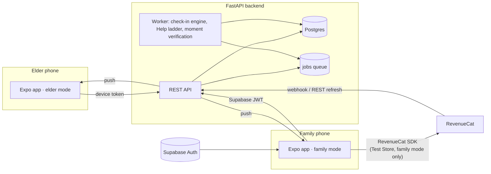

# Nodly

**A daily nod that says I'm okay.**

The home app for older adults, and the family app for the people who love them. One codebase, two modes: a calm elder home screen with a giant **"I'm okay"** button, and a family app that sees check-ins, gets alerts, and shares photos and voice notes — never text messages.

Built for the **RevenueCat Shipaton 2026 — Next Gen** award.

---

## 60-second overview

- **Elder mode:** one big button a day ("I'm okay"), family photo/voice moments, a one-tap **Help** button with an automatic countdown and an escalation ladder to the family.
- **Family mode:** see check-in status at a glance (today + a 7-day strip), get a push the moment something's wrong, share a moment back, and manage **Nodly Plus**.
- **The loop that pays for itself:** share one qualifying photo or voice note a day, and **Nodly Plus** (longer check-in history, and more down the line) stays free for the whole family — no subscription needed. Miss a day and don't want to share? A $2.99 Day Pass or a subscription unlocks it instead, confirmed server-side through RevenueCat.
- **Safety is never paywalled.** Check-ins, reminders, Help and the moments feed are free, always. Elders never see a paywall or any purchase UI — enforced by a build-time ESLint rule, not just a promise.

## Screenshots

See [`docs/screenshots/`](docs/screenshots) for the elder home, the family dashboard, sharing a moment, the Help countdown and alert, the locked-feature sheet, a Test Store purchase, and the Plus & billing timeline.

## Architecture



- **Backend:** FastAPI + SQLAlchemy 2 (async) + Postgres, with a DB-backed job queue and worker (no Redis). The worker runs the check-in engine (reminders, missed-check-in alerts), the Help escalation ladder, and moment verification (ffprobe/Pillow).
- **Mobile:** one Expo app, two modes chosen at first launch. Expo Router, TanStack Query, Zustand, i18next. Elders authenticate with a long-lived device token; family members sign in with Supabase (email OTP).
- **Billing:** a server-side ledger (`access_grants`) is the only judge of whether a family has Plus. Nothing on the client ever unlocks a feature by itself.

## Stack

- **Backend:** Python 3.12, FastAPI, SQLAlchemy 2 (async) + asyncpg, Alembic, Pydantic v2, Pillow + imagehash, ffmpeg/ffprobe, pytest.
- **Mobile:** Expo (SDK 57), TypeScript (strict), Expo Router, TanStack Query, Zustand, i18next, `react-native-purchases`.
- **Data:** Postgres (local in dev, Supabase-hosted for family auth).

## How RevenueCat powers it

- **Entitlement:** `plus`. **Products:** `day_pass` (consumable, $2.99, 24 hours), `plus_monthly` / `plus_annual` (subscriptions).
- **Server-side validation only.** A Day Pass or subscription is recorded from RevenueCat alone — the `NON_RENEWING_PURCHASE`/renewal webhook, verified against an `Authorization` header (and optional HMAC signature), or `POST /access/refresh`, which asks RevenueCat's REST API directly if the webhook hasn't arrived yet. The app never decides access; it polls `GET /access` and shows "Confirming…" until the server agrees.
- **The free loop:** a qualifying photo or voice note posted by a non-elder family member grants Plus from the start of that day through the end of the next (family-clock day, DST-safe). One grant per family per day — extra moments don't stack.
- **Refunds revoke the matching grant**, even if the refund webhook arrives before the purchase one.
- **The RevenueCat **Test Store** is used for all Shipaton purchases** (dev-only key, never shipped). Every purchase is idempotent by store transaction id — a webhook and a `/access/refresh` for the same transaction only ever grant once.
- **Elders never see a paywall or purchase UI** — enforced both by product design and by an ESLint rule that forbids importing any purchase code from elder-mode screens.

See [`docs/DECISIONS.md`](docs/DECISIONS.md) (D73–D78) for the full design record.

## Run it locally

Full setup is in [`docs/SETUP.md`](docs/SETUP.md). Short version:

```bash
# Backend
cd backend
conda create -n nodly python=3.12 && conda activate nodly
pip install -e ".[dev]"
cp .env.example .env            # fill in DATABASE_URL, CODE_HASH_SECRET, SUPABASE_URL, ...
alembic upgrade head
python -m uvicorn nodly.main:create_app --factory --port 8000
python -m nodly.worker          # in a second terminal

# Mobile
cd mobile
npm install
cp .env.example .env            # EXPO_PUBLIC_API_URL, Supabase keys, ...
npm run gen:api                 # generates src/api/schema.d.ts from backend/openapi.json
npx expo start --dev-client
```

An Android dev build is needed (not Expo Go) — it uses native modules (camera, audio, purchases). See `SETUP.md` for EAS build profiles.

## Working now vs. coming next

**Working now:** two-mode onboarding and pairing; the check-in engine (reminders, missed-check-in alerts, a 7-day strip); the Help escalation ladder with a countdown, live status and resolution; photo and voice moments (upload queue, server-side verification, a family feed and an elder viewer); Nodly Plus billing end to end (moment credits, Day Pass, subscriptions, refunds, a plain-language billing timeline, "Report a problem").

**Coming next** (designed, not built — see `/design` and `docs/PROGRESS.md`): video moments; the AI voice recipe assistant and Nodly Kitchen; a universal music hub; the Android home-launcher mode and widgets; live presence; SMS/voice Help escalation; Google Play and the App Store (Galaxy Store first, per the Shipaton "Best App for Galaxy" category).

## Shipaton Next Gen

Built solo for RevenueCat's Shipaton 2026, Next Gen award. The RevenueCat SDK powers the app's only in-app purchase, validated server-side; the app targets the Samsung Galaxy Store first. See [`docs/VIDEO_SCRIPT.md`](docs/VIDEO_SCRIPT.md) for the demo video script and [`docs/DEVPOST.md`](docs/DEVPOST.md) for the submission copy.

## Licence

MIT — see [`LICENSE`](LICENSE).
